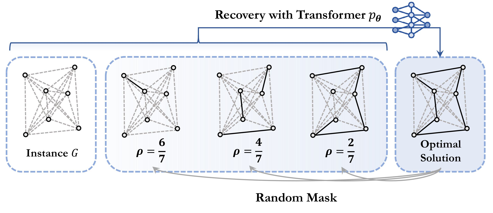
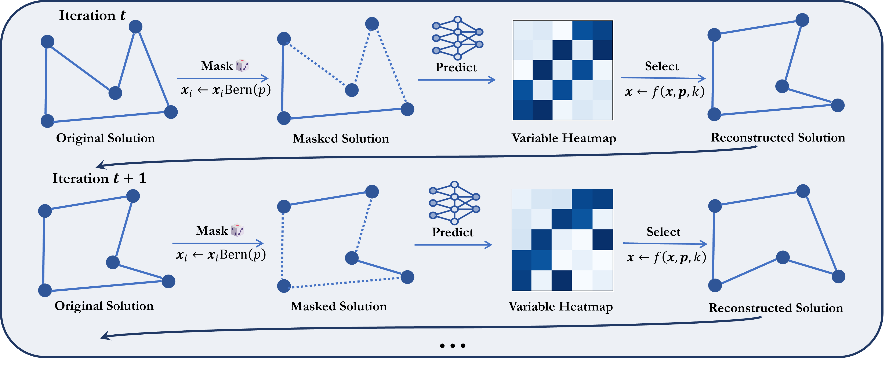

# MaskCO: Masked Generation Drives Effective Representation Learning and Exploiting for Combinatorial Optimization

> ## 📖 想了解这个仓库 / Start here
>
> 本仓库不只是上游论文代码，而是一个**组合工作区**：上游 MaskCO（ICLR 2026）源码 + **DynMaskCO-CC 动态冷链扩展研发** + **CC_Compare 对比方法复现** + **完整研发证据树（登记 / 独立审计 / 回执）**。
>
> | 想了解 | 直接打开 |
> |---|---|
> | **当前权威状态（唯一入口，先看这个）** | [`项目当前状态.md`](C-VRP_Cold-chainVehicleRoutingProblem/项目当前状态.md) |
> | 工作区目录地图与规则 | [`工作区导航.md`](工作区导航.md) |
> | 最新研究记录（第 1 轮：A-v1 效用上界） | [`取货A-v1预算可达上界与选择缺口_2026-10-13.md`](C-VRP_Cold-chainVehicleRoutingProblem/docs/当前规划/决策与审计/取货A-v1预算可达上界与选择缺口_2026-10-13.md) |
> | 最新研究记录（第 2 轮：预算保留接拒面板） | [`取货A-v1预算保留接拒面板_2026-10-13.md`](C-VRP_Cold-chainVehicleRoutingProblem/docs/当前规划/决策与审计/取货A-v1预算保留接拒面板_2026-10-13.md) |
> | 双线工程记录（评分头泛化 / 惰性复用） | [`双线第六轮_评分头泛化与全场景惰性复用_2026-10-13.md`](C-VRP_Cold-chainVehicleRoutingProblem/docs/当前规划/决策与审计/双线第六轮_评分头泛化与全场景惰性复用_2026-10-13.md) |
> | 扩展代码 | [`C-VRP_Cold-chainVehicleRoutingProblem/scripts/`](C-VRP_Cold-chainVehicleRoutingProblem/scripts/) |
> | 研发证据树（登记 / 审计 / RESULT / 回执） | [`research/review_3080_20261010/`](research/review_3080_20261010/) |
> | **原始证据归档**（≥1 MiB 的原始转储，约 5.3 GB → 压缩 406 MiB） | [**Release 下载**](https://github.com/GoodThing001/DynMaskCO/releases/tag/evidence-2026-10-13) · [`EVIDENCE_MANIFEST.md`](EVIDENCE_MANIFEST.md) |
>
> **一句话现状（2026-10-13）**：**尚未建立稳定、可归因的 MaskCO 核心在线正向增益**。取货 A-v1 线首次出现**预登记、受控、独立核查的正向线索**——5 个冻结日受控 A/B 配对差 `[0, +102.92, +24.76, 0, 0]`，均值 **+25.54**，0 天为负，机制是把能量预算从最不划算的类补回到最划算的类（类 0 服务率 0.59→0.80）。按项目自己的预登记口径，这**只是线索**，需另登记并执行 40 天阶段才能称为增益。配送线需主干训练（本机内存低于登记的 8 GiB 门槛）。
>
> **仓库边界（重要）**：为满足 GitHub 的 100 MB 单文件上限并避免 15 倍膨胀，本仓库**不跟踪 ≥1 MiB 的原始审计转储**（`STATES.jsonl` / `*FULLRAW.json` / `REQUEST_*.json` / `downloaded/` 等，共 474 个文件、约 5.3 GB；完整清单见仓库 `.gitignore` 的 generated 块与 [`EVIDENCE_MANIFEST.md`](EVIDENCE_MANIFEST.md)）。这些文件**未删除**，打包在上述 Release 附件中。**全部源码、文档、登记 / 审计 / 回执与 <1 MiB 工件都在库内。**
>
> **诚实边界（务必阅读后再引用任何数字）**：所有结果均为作者自测的**工程/机制证据**，不是论文级结论；过期的 `项目当前状态.md` 顶部旧条目按时间快照理解，以最新条目与上表记录为准。

---

Official implementation of **ICLR 2026** paper "[MaskCO: Masked Generation Drives Effective Representation Learning and Exploiting for Combinatorial Optimization](https://openreview.net/forum?id=psUjNnLhl9)".

> Workspace note: the unmodified upstream MaskCO implementation is stored in [`MASKCO_code/`](MASKCO_code/). The dynamic cold-chain extension is developed independently in [`C-VRP_Cold-chainVehicleRoutingProblem/`](C-VRP_Cold-chainVehicleRoutingProblem/). See the [workspace guide](工作区导航.md) for the current layout.

Neural Combinatorial Optimization (NCO) has long been anchored in paradigms such as solution construction or improvement that treat the solution as a monolithic reference, squandering the rich local decision patterns embedded in high-quality solutions. Inspired by the scalability of self-supervised pretraining in language and vision, we propose a shift in perspective: Can combinatorial optimization adopt a fundamental training paradigm to enable scalable representation learning? We introduce MaskCO, a masked generation approach that reframes learning to optimize as self-supervised learning on given reference solutions. By strategically masking portions of optimal solutions and training models to recover the missing content, MaskCO turns a single instance-solution pair into a multitude of local learning signals, forcing the model to internalize fine-grained structural dependencies. At inference time, we employ a mask-and-reconstruct procedure, i.e., a refinement loop that iteratively masks variables and regenerates them to progressively improve solution quality. Our findings show that these learned representations are highly transferable, facilitating effective fine-tuning and boosting the performance of alternative inference approaches. Experimental results demonstrate that MaskCO achieves remarkable performance improvements over previous state-of-the-art neural solvers, reducing the optimality gap by more than 99% and achieving a 10x speedup on problems such as the Travelling Salesman Problem (TSP).





## Setup
```
cd MASKCO_code
sh install.sh
cd lib && make
```

## Checkpoints
Checkpoints can be downloaded from [Google Drive](https://drive.google.com/drive/folders/1Y9kN7H5qvlsgbnOKih6hpkpcF2MHUreI?usp=sharing). To evaluate them, run the scripts in the `MASKCO_code/tsp_scripts/eval`, `MASKCO_code/cvrp_scripts/eval`, and `MASKCO_code/mis_scripts/eval` directories.

## Training  
Training scripts are located in `MASKCO_code/tsp_scripts/train`, `MASKCO_code/cvrp_scripts/train`, and `MASKCO_code/mis_scripts/train`.

- The TSP-100/500 training data is sourced from [ML4TSPBench](https://github.com/Thinklab-SJTU/ML4TSPBench), TSP-1000 training data is sourced from [ML4CO-Bench-101](https://github.com/Thinklab-SJTU/ML4CO-Bench-101).
- The MIS training data is the same as that used in [Fast-T2T](https://github.com/Thinklab-SJTU/Fast-T2T).  
<!-- - The CVRP training data ... -->
